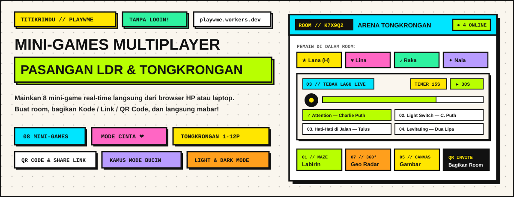
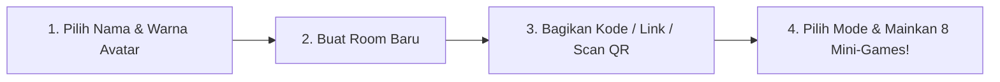
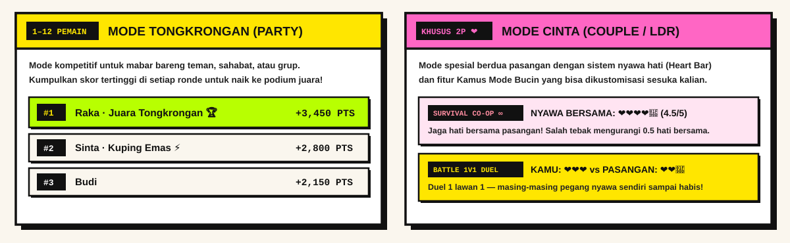
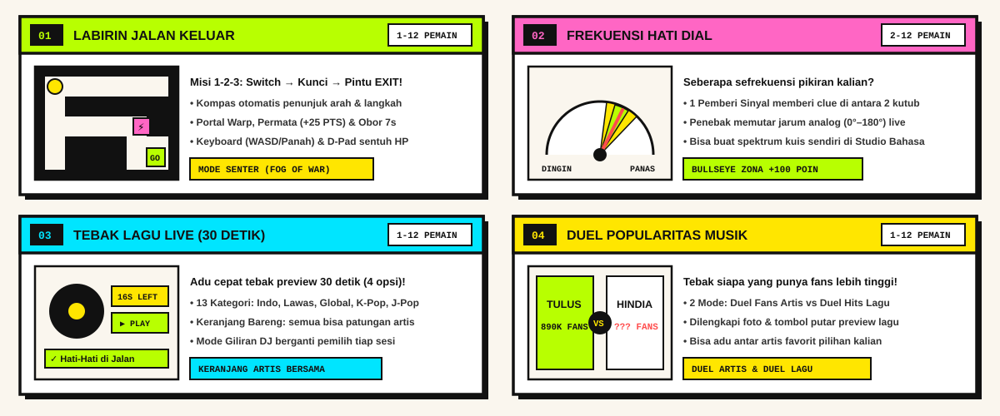
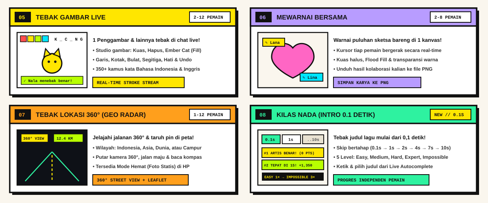

# 🎮 TitikRindu
### **Platform Mini-Games Multiplayer Real-Time untuk Pasangan LDR & Tongkrongan**

### 🌐 **Link Main Langsung:** [**https://titikrindu.web.id**](https://titikrindu.web.id)

  
  
  
  

---

## ✨ Apa Itu TitikRindu?

**TitikRindu** adalah aplikasi web **mini-games multiplayer real-time** dengan desain visual **Neobrutalism** yang dibuat khusus untuk:
- 💑 **Pasangan LDR / Couple** yang ingin quality time seru jarak jauh sambil teleponan atau Discord.
- 🎉 **Teman Tongkrongan, Sahabat, & Keluarga** (hingga 12 pemain dalam 1 room) untuk mabar santai maupun adu skor kompetitif.
- 🎧 **Main Solo (1 Pemain)** untuk latihan tebak lagu, eksplorasi peta dunia 360°, atau menaklukkan labirin.

Tidak perlu download aplikasi, tidak perlu registrasi akun atau login email. **Buka webnya di HP atau laptop → Buat Room → Bagikan Kode / QR Code → Langsung Main!**

---

## 🚀 Cara Main Bareng dalam 30 Detik

1. **Atur Identitas Singkat:** Masukkan nama panggilanmu, pilih warna kartu favorit, dan pilih ikon avatar.
2. **Buat atau Gabung Room:** Klik **Buat Room** untuk menjadi Host, atau masukkan **Kode Room 6 karakter** (bisa juga langsung klik link undangan atau scan **QR Code** dari layar temanmu).
3. **Pilih Mode & Game:** Host bisa bebas mengganti permainan kapan saja di dalam room tanpa perlu membuat room baru!

---

## 🎭 2 Mode Permainan: Tongkrongan vs Mode Cinta

| Mode Room | Jumlah Pemain | Sistem & Tujuan Permainan |
| :--- | :-: | :--- |
| 🏆 **Mode Tongkrongan (Party)** | **1 – 12 Pemain** | Setiap pemain berlomba mengumpulkan **poin tertinggi** dalam jumlah ronde yang ditentukan (`4`–`15` ronde). Di akhir sesi muncul **Podium Juara** beserta total akumulasi skor. |
| ❤️ **Mode Cinta — Survival Co-op** | **2 Pemain (Couple)** | Pasangan berbagi **Nyawa Bersama (`Shared Hearts`)**. Setiap kali ada yang salah menebak atau waktu habis, nyawa bersama berkurang. Bertahanlah bersama melewati sebanyak mungkin ronde! |
| ⚔️ **Mode Cinta — Battle 1v1** | **2 Pemain (Couple)** | Duel romantis *sudden death*: masing-masing memegang nyawa hati sendiri. Siapa yang nyawanya habis duluan kalah, dan yang bertahan terakhir menjadi pemenang! |

---

## 🕹️ Galeri 8 Mini-Games

### Bagian 1 — Game `#01` s/d `#04`

#### `01` 🧭 Labirin Jalan Keluar (*Co-op & Race Maze Escape*)
- **Misi 1-2-3:** Ikuti **Kompas Target Otomatis** di atas layar untuk mencari **Switch Petir ⚡** (membuka gerbang laser), ambil **Kunci Emas 🔑**, lalu lari menuju pintu **EXIT 🚪**!
- **Fitur Seru:** Masuk ke **Portal Warp 🌀** untuk teleportasi instan, kumpulkan **Permata Biru (`+25 PTS`)**, dan ambil **Obor Kuning 🔥** untuk membuka gelapnya **Mode Senter (*Fog of War*)** selama 7 detik.
- **Kontrol Nyaman:** Bisa dimainkan dengan keyboard (`WASD` / tombol Panah) di laptop maupun tombol **D-Pad sentuh** di layar HP.

#### `02` 🎛️ Frekuensi Hati Dial (*Mind Spectrum Dial*)
- **Konsep:** Menguji seberapa sefrekuensi pikiranmu dengan pasangan atau temanmu!
- **Cara Main:** Satu pemain menjadi **Pemberi Sinyal** yang melihat lokasi target rahasia pada setengah lingkaran (`0°–180°`) di antara dua kutub kata (contoh: *Dingin ↔ Panas*, *Overthinking ↔ Santai*), lalu memberikan **1 kalimat petunjuk (clue)**.
- **Penilaian:** Pemain lain memutar jarum analog secara live ke sudut yang mereka yakini tepat. Semakin dekat dengan pusat target (**Bullseye**), semakin tinggi poinnya (`+100 PTS`).

#### `03` 💿 Tebak Lagu Live (*30s Audio Beat Battle*)
- **Cara Main:** Dengarkan potongan preview lagu asli berdurasi 30 detik yang berputar di piringan hitam (*Vinyl Deck*), lalu adu cepat memilih judul & penyanyi yang benar dari **4 pilihan ganda** sebelum timer 20 detik habis!
- **13 Kategori Musik:** *Indo Hits, Indo Lawas, Global Top, K-Pop, Jepang / Anime (J-Pop), Rock & Alt, EDM & Party, R&B / Hip-Hop, Indie & Chill, 2000s Throwback, Dangdut Asli, Koplo & Jawa,* hingga *Latin & Vibe*.
- **Keranjang Artis Bersama & Giliran DJ:** Semua pemain di room bisa ikut memasukkan nama penyanyi/band favorit mereka ke dalam **Keranjang Bareng** secara live untuk diacak menjadi soal kuis!

#### `04` 🔥 Duel Popularitas (*Higher or Lower Music Duel*)
- **2 Sub-Mode:**
  1. **Duel Artis:** Tebak siapa artis/band yang memiliki jumlah penggemar (*Fans*) lebih banyak.
  2. **Duel Lagu:** Tebak lagu mana yang memiliki tingkat popularitas global lebih tinggi.
- **Preview Audio Langsung:** Setiap kartu VS dilengkapi foto sampul dan tombol putar lagu agar kamu bisa mendengarkan cuplikan lagunya sebelum memilih.

---

### Bagian 2 — Game `#05` s/d `#08`

#### `05` 🎨 Tebak Gambar Live (*Sketch & Guess Studio*)
- **Cara Main:** Bergiliran menjadi **Penggambar** selama 75 detik sementara pemain lain mengetik tebakan di kolom chat live. Huruf petunjuk terbuka bertahap seiring waktu berjalan.
- **Perkakas Gambar Lengkap:** Kuas bebas, penghapus, **Ember Cat (*Flood Fill*)**, penggaris garis lurus, kotak, lingkaran, segitiga, bentuk hati (mode garis maupun isi penuh), pengatur ukuran & transparansi kuas, palet warna + *custom color picker*, serta `Undo / Redo`.
- **Kamus Kata Bilingual:** Lebih dari **350+ kata** Bahasa Indonesia & Inggris yang mudah dikenali.

#### `06` 🖌️ Mewarnai Bersama (*Co-op Coloring Book*)
- **Cara Main:** Pilih dari puluhan sketsa gambar lucu (hewan, pemandangan, makanan, karakter, tema cinta) lalu warnai bersama-sama di satu kanvas secara real-time!
- **Fitur Kolaborasi:** Kamu bisa melihat indikator nama dan pergerakan kuas pasangan/temanmu secara langsung, memakai *flood fill* maupun kuas transparan, dan menekan tombol **Simpan PNG** untuk mengunduh hasil lukisan kalian.

#### `07` 📍 Tebak Lokasi 360° (*Geo Radar / Street View Atlas*)
- **Cara Main:** Kamu diterjunkan ke lokasi jalanan nyata di **Indonesia**, **Asia**, **Keliling Dunia**, atau **Acak Campur**.
- **Navigasi 360° & Kompas:** Geser layar untuk menengok 360° ke segala arah, klik panah di jalanan untuk berjalan maju/mundur mencari petunjuk plang nama jalan, bahasa, atau plat nomor, lalu jatuhkan pin tebakanmu di **Peta Interaktif**.
- **Skor Akurasi Jarak & Mode Hemat:** Semakin dekat jarak pin kamu (dalam `km`) ke titik asli, semakin besar skornya (+bonus **Pin Terdekat**). Tersedia juga tombol **Mode Hemat (Foto Statis)** bagi pengguna HP yang ingin menghemat kuota data.

#### `08` 🎧 Kilas Nada (*Intro Snap 0.1s — Tebak Lagu v2*)
- **Tantangan Kuping Emas:** Bisakah kamu menebak judul lagu hanya dari **0,1 detik pertama**?
- **Buka Durasi Bertahap (*Skip Ladder*):** Jika `0,1 detik` masih terlalu singkat, klik **Skip** (atau coba tebak dulu) untuk membuka potongan durasi yang lebih panjang secara bertahap:
  `0.1s → 1s → 2s → 4s → 7s → 10s`.
- **5 Tingkat Kesulitan & Multiplier Skor:**
  | Level | Tangga Durasi Klip | Kesempatan | Petunjuk / Hint | Batas Waktu | Pengali Skor |
  | :--- | :--- | :-: | :--- | :-: | :-: |
  | 🟢 **EASY** | `0.1s · 1s · 2s · 4s · 7s · 10s` | 6× | 🟡 Badge **Artis Benar** + Inisial Artis di tahap akhir | 75 detik | **1.0×** |
  | 🔵 **MEDIUM** | `0.1s · 1s · 2s · 4s · 7s · 10s` | 6× | 🟡 Badge **Artis Benar** | 60 detik | **1.25×** |
  | 🟡 **HARD** | `0.1s · 1s · 2.5s · 5s · 10s` | 5× | Tanpa hint (murni Benar / Salah) | 45 detik | **1.5×** |
  | 🟠 **EXPERT** | `0.1s · 1s · 2s · 4s` *(Maks 4 detik!)* | 4× | Tanpa hint | 35 detik | **2.0×** |
  | 🔴 **IMPOSSIBLE** | `0.1s · 0.5s · 1s` *(Maks 1 detik!)* | 3× | Tanpa hint · **Mode Kuping Dewa** | 25 detik | **3.0×** |
- **Live Song Autocomplete Anti-Spoiler:** Ketik potongan judul atau nama penyanyi (misal `"charlie"` atau `"alan walker"`), lalu pilih lagu dari daftar saran yang langsung muncul. 
- **Progres Independen Multiplayer:** Setiap pemain di room bisa melakukan *Skip* atau menebak di durasi masing-masing tanpa mengganggu durasi klip pemain lain!

---

## 💡 Fitur Spesial di Dalam Room

- 💬 **Panel Obrolan & Reaksi Cepat (*Quick Reactions*):** Kirim stiker reaksi melayang dan pesan singkat ke seluruh pemain di room kapan saja.
- 🗣️ **Studio Bahasa & Kamus Mode Bucin:** Ubah bahasa tampilan antara **Indonesia**, **English**, atau **Mode Bucin**, bahkan ganti istilah-istilah di dalam game dengan panggilan kesayangan kalian lalu sinkronkan ke layar pasanganmu!
- 🌗 **Light Mode & Dark Mode:** Tampilan otomatis menyesuaikan kenyamanan mata siang maupun malam dengan palet warna pastel-neon yang tetap tajam.
- 🔄 **Auto-Reconnect Pintar:** Jika tab browser tidak sengaja tertutup atau sinyal HP sempat terputus, cukup buka kembali room yang sama — skor, hati, dan giliranmu tetap aman.

---

## ❓ Tanya Jawab Umum (FAQ)

<strong>1. Apakah perlu install aplikasi atau daftar akun?</strong>

 
Tidak perlu sama sekali. <strong>TitikRindu</strong> berjalan 100% di browser modern (Chrome, Safari, Edge, Firefox) baik di Android, iPhone/iPad, Windows, maupun Mac.

<strong>2. Apakah bisa dimainkan dari jaringan WiFi atau kuota seluler yang berbeda kota/negara?</strong>

 
Bisa! Sistem koneksi room dilengkapi jalur ganda otomatis (P2P &amp; Cloud Relay) sehingga tetap terhubung lancar meskipun pemain berada di kota atau negara yang berbeda maupun memakai jaringan operator seluler 4G/5G.

<strong>3. Apakah bisa main sendirian (1 pemain)?</strong>

 
Bisa! Sebagian besar game seperti <em>Kilas Nada (0.1s)</em>, <em>Tebak Lagu Live</em>, <em>Tebak Lokasi 360°</em>, <em>Duel Popularitas</em>, dan <em>Labirin Jalan Keluar</em> mendukung penuh permainan solo 1 pemain untuk latihan atau memecahkan rekor skor pribadi.

<strong>4. Bagaimana jika kuota internet sedang terbatas saat main Tebak Lokasi 360°?</strong>

 
Di dalam game <strong>Tebak Lokasi (Geo Radar)</strong> terdapat tombol <strong>Mode Hemat</strong> di pojok atas layar untuk mengganti tampilan kamera jalanan 360° menjadi foto statis yang jauh lebih hemat data.

---

## 📬 Masukan, Saran Mini-Game, & Lapor Bug

Punya ide mini-game baru yang seru untuk dimainkan bareng pasangan/tongkrongan, atau menemukan bug saat bermain? Kamu bisa menghubungi kami lewat salah satu cara berikut:

- 🐛 **GitHub Issues:** Buka laporan atau saran baru di tab [**GitHub Issues**](../../issues) pada repositori ini.
- 📧 **Email Langsung:** Kirim pesan ke [**Nino**](mailto:sv.nononino@gmail.com?subject=%5BTitikRindu%20%2F%20PlayWMe%5D%20Saran%20atau%20Lapor%20Bug) 

> **Tips agar cepat ditindaklanjuti:** Sertakan nama game, tangkapan layar (*screenshot*), serta perangkat & browser yang digunakan (contoh: *iPhone Safari* atau *Android Chrome*).

---

  <strong>Dibuat dengan ❤️ untuk mendekatkan yang jauh &amp; meramaikan setiap tongkrongan.</strong>

